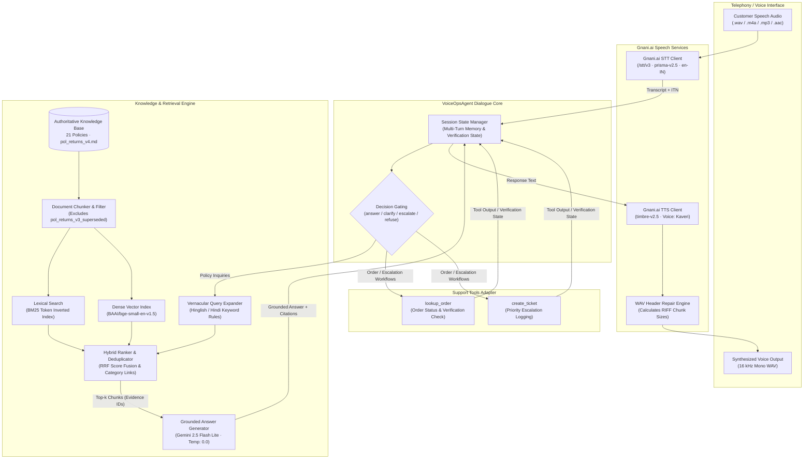

# ZentroMart VoiceOps

[](https://www.python.org/downloads/)
[]()
[]()
[]()
[]()
[](https://github.com/sc-likes-to-code/zentromart-voiceops)

> **IIT Guwahati × Gnani.ai TOKENS→TRANSFORMERS VoiceOps Capstone 2026**
> An autonomous, voice-enabled, policy-grounded customer support agent for **ZentroMart**, an Indian e-commerce marketplace. Combines Gnani.ai speech recognition and synthesis, hybrid dense-sparse retrieval-augmented generation (RAG), structured multi-turn conversation memory, caller identity verification, and strict policy boundary governance.

---

## Table of Contents

- [Overview](#overview)
- [Key Capabilities](#key-capabilities)
- [Demonstration](#demonstration)
- [System Architecture](#system-architecture)
- [Technology Stack](#technology-stack)
- [Repository Structure](#repository-structure)
- [Installation & Setup](#installation-setup)
- [Running the Project](#running-the-project)
  - [Batch Audio Evaluation (`run.py`)](#batch-audio-evaluation-runpy)
  - [Command-Line Interface (`src/cli.py`)](#command-line-interface-srcclipy)
  - [Live Demonstration Runner (`demo/run_live_demo.py`)](#live-demonstration-runner-demorunlivedemopy)
- [RAG & Knowledge Grounding](#rag-knowledge-grounding)
- [Evaluation & Benchmark Results](#evaluation-benchmark-results)
  - [52-Question Development Benchmark](#1-52-question-development-benchmark)
  - [15-Question Generalisation Evaluation](#2-independent-15-question-generalisation-evaluation)
- [Testing](#testing)
- [Project Limitations & Future Work](#project-limitations-future-work)
- [Security & Responsible Use](#security-responsible-use)
- [Submission Deliverables](#submission-deliverables)
- [Acknowledgements](#acknowledgements)

---

## Overview

Modern e-commerce voice telephony demands high accuracy, strict policy compliance, and predictable behavior. Generic conversational bots often hallucinate return terms, reveal private customer information to unauthenticated callers, or fail to follow regulatory escalation procedures.

**ZentroMart VoiceOps** solves these challenges by combining:
1. **Speech Pipeline**: Speech-to-Text (STT) and streaming Text-to-Speech (TTS) using **Gnani.ai** APIs exclusively.
2. **Hybrid RAG Engine**: Lexical (BM25) and dense semantic (`BAAI/bge-small-en-v1.5` via FastEmbed) search over authoritative store policies.
3. **Structured Dialogue Governance**: A discrete 4-way decision framework (`answer`, `clarify`, `escalate`, `refuse`) that gates private account data behind a two-factor verification check and escalates high-risk claims (> ₹10,000 damaged goods) to specialists.
4. **Grounded Synthesis**: Powered by **Google Gemini** (`gemini-3.5-flash-lite`) constrained by strict prompt rules that prevent hallucinated terms and cite exact source policy chunk IDs.

---

## Key Capabilities

- **Voice Input & Spoken Responses**: Ingests audio files in `.wav`, `.m4a`, `.mp3`, and `.aac` formats, transcribes speech, reasons over the store's knowledge base, and synthesizes 16 kHz WAV audio responses.
- **Exclusive Gnani.ai Speech Services**: STT via `/stt/v3` (`prisma-v2.5`, `en-IN`) with Inverse Text Normalization (ITN) for accurate alphanumeric order IDs; Neural TTS via `timbre-v2.5` (`Kaveri`, Indian English). Includes automatic WAV RIFF header repair to ensure complete, uninterrupted playback on Windows audio systems.
- **Evidence-Grounded Policy RAG**: Indexes 21 policy markdown documents with frontmatter status filtering. Actively excludes superseded policies (e.g., `pol_returns_v3_superseded.md`) and unverified agent logs to prevent contradictory answers.
- **Evidence & Chunk Attribution**: Every response explicitly binds its statements to document section IDs (`[RET-2]`, `[RET-8]`) and returns exact retrieved chunk IDs (e.g., `pol_returns_v4.md:RET-2:2`).
- **Multi-Turn Context Retention**: Maintains session state across turns, resolving contextual follow-ups, implicit references, and pronouns (e.g., *"Is there any reverse pickup fee for returning it?"*) without re-prompting the customer.
- **Caller Verification & Privacy Guard**: Requires matching either the last 4 digits of the registered phone number or the 6-digit delivery pincode before disclosing private order status or tracking details. Enforces safe single-retry handling and locks the session upon repeated verification failures.
- **Support Workflows (Mock Tools Adapter)**:
  - `lookup_order`: Queries order status, shipment dates, delivery items, and payment methods from local synthetic databases. Withholds PII for unverified sessions.
  - `create_ticket`: Creates synthetic internal customer support tickets when an issue meets policy escalation thresholds (e.g., damaged items > ₹10,000, unserviceable pin code disputes, or human agent requests).
- **Batch Audio Processing**: The batch runner (`run.py`) processes entire directories of audio calls sequentially, generating speech outputs, transcripts, text answers, and structured JSON metadata per turn.

---

## Demonstration

The repository includes a recorded video demonstration ([demo.mp4](demo.mp4)) showcasing live, unedited system execution across two core scenarios:

> **Video Link**: [**Watch Demonstration Video (`demo.mp4`)**](demo.mp4)
> **Duration**: 81 seconds (1m 21s) | **Resolution**: 1920×1080 Full HD | **Audio**: H.264 / AAC Stereo

### Demonstrated Scenarios

1. **Scenario A — Grounded Return Policy & Multi-Turn Context Follow-Up**:
   - **Turn 1**: The customer asks about return windows for clothing and footwear. The agent retrieves `pol_returns_v4.md` (`RET-2`, `RET-8`), identifies the standard 15-day window, notes the 30-day extended window for festive sale orders, and speaks the answer in Kaveri's voice.
   - **Turn 2**: The customer follows up with an elliptical query: *"Is there any reverse pickup fee for returning it?"*. The agent retains the conversation context (clothing/footwear category) and cites `RET-6` (₹49 flat fee, waived for ZentroMart Plus members or damaged shipments) without asking the user to repeat the product name.
2. **Scenario B — Safety Policy Gating & High-Value Damage Escalation**:
   - A customer inquires about the procedure for an expensive electronic item valued above ₹10,000 that arrived damaged.
   - The agent evaluates policy `pol_damaged_wrong_missing.md` (`DWM-3`), identifies that damage claims exceeding ₹10,000 must not be resolved unilaterally by Tier-1 bots, triggers the `escalate` decision gate, instructs the user on the 48-hour reporting requirement with unboxing photos, and routes the case to the Priority Resolution team.

For complete transcripts, timing cue sheets, and recording instructions, see:
- [demo/demo_scenarios.md](demo/demo_scenarios.md) — Detailed scenario specification, chunk IDs, and prompts.
- [demo/demo_script.md](demo/demo_script.md) — Second-by-second presenter cue sheet.
- [demo/recording_runbook.md](demo/recording_runbook.md) — OBS Studio configuration and audio routing guide.

---

## System Architecture



### Module Responsibilities

| Module | File Path | Core Responsibility |
| :--- | :--- | :--- |
| **Agent Core** | [`src/agent.py`](src/agent.py) | Manages dialogue flow, caller identity state, decision classification, and tool dispatch. |
| **Grounded Answering** | [`src/answering.py`](src/answering.py) | Interacts with Google Gemini (`gemini-3.5-flash-lite`), enforcing strict citation and abstention boundaries. |
| **Hybrid Retrieval** | [`src/retrieval.py`](src/retrieval.py) | Combines BM25 and FastEmbed dense search; implements vernacular expansion, product deduplication, and category policy linkage. |
| **Voice Pipeline** | [`src/voice.py`](src/voice.py) | Orchestrates Gnani.ai STT transcription, TTS synthesis, turn artifact persistence, and WAV header reconstruction. |
| **Knowledge Ingestion** | [`src/ingestion.py`](src/ingestion.py) | Parses Markdown frontmatter, splits documents by policy section IDs, and purges superseded versions. |
| **Tools Adapter** | [`src/tools_adapter.py`](src/tools_adapter.py) | Provides a security-gated interface to local synthetic tools (`lookup_order`, `create_ticket`). |
| **Conversation State** | [`src/conversation.py`](src/conversation.py) | Dataclasses for turn history, verification status, and retry counters. |
| **Configuration** | [`src/config.py`](src/config.py) | Centralizes environment variables, model identifiers, thresholds, and filesystem paths. |

---

## Technology Stack

- **Runtime & Language**: Python 3.10+
- **Large Language Model (LLM)**: Google Gemini 2.5 Flash Lite (`gemini-3.5-flash-lite` via the official `google-genai` SDK) running at `temperature=0.0` for deterministic, grounded outputs.
- **Speech-to-Text (STT)**: Gnani.ai `/stt/v3` REST & WebSocket endpoint (`prisma-v2.5`, Indian English `en-IN`, Inverse Text Normalization).
- **Text-to-Speech (TTS)**: Gnani.ai Neural Speech API (`timbre-v2.5`, Voice: `Kaveri`, Indian English `en-IN`, 16 kHz 16-bit Mono PCM).
- **Dense Vector Embeddings**: `BAAI/bge-small-en-v1.5` (384-dimensional dense vectors) executed locally via `fastembed` (no external vector database service required).
- **Lexical Search**: Custom in-memory BM25 index with token length normalization and query expansion.
- **Audio I/O & Playback**: Python `winsound` (Windows native) and custom binary RIFF header recalculation.
- **Testing & Verification**: `pytest` 8.0+.

---

## Repository Structure

```text
zentromart-voiceops/
├── README.md                      # Comprehensive project documentation
├── requirements.txt               # Pinned Python package dependencies
├── .env.example                   # Template for API credentials
├── .gitignore                     # Exclusion rules (caches, .env, .venv, *.zip)
├── demo.mp4                       # 81-second recorded demonstration video
├── report.pdf                     # 4-page capstone technical report
├── run.py                         # Batch evaluation runner for customer audio folders
├── src/                           # Complete application source code
│   ├── agent.py                   # Multi-turn VoiceOpsAgent & business logic
│   ├── answering.py               # Grounded answer generator (Gemini Flash Lite)
│   ├── cli.py                     # Command-line interface
│   ├── config.py                  # System paths and configuration constants
│   ├── conversation.py            # Session and turn state dataclasses
│   ├── ingestion.py               # Knowledge base chunking & metadata parser
│   ├── retrieval.py               # Hybrid BM25 & dense vector search engine
│   ├── tools_adapter.py           # Gated wrapper for mock customer support tools
│   └── voice.py                   # Gnani.ai STT/TTS pipeline & WAV repair
├── tests/                         # Automated test suite (67 tests)
│   ├── test_agent.py              # Identity verification & escalation unit tests
│   ├── test_answering.py          # Grounding, citation, and abstention tests
│   ├── test_baseline.py           # Zero-shot baseline evaluation tests
│   ├── test_cli.py                # CLI argument parsing tests
│   ├── test_ingestion.py          # Document parsing & superseded policy exclusion tests
│   ├── test_retrieval.py          # BM25 & dense hybrid retrieval tests
│   ├── test_run_batch.py          # Batch runner integration tests
│   └── test_voice.py              # Gnani audio pipeline & exclusivity tests
├── demo/                          # Demonstration scripts and documentation
│   ├── demo_scenarios.md          # Full transcripts and policy citations
│   ├── demo_script.md             # Second-by-second presenter cue sheet
│   ├── recording_runbook.md       # OBS Studio setup & audio configuration guide
│   └── run_live_demo.py           # High-visibility demonstration runner
├── outputs/                       # Evaluation reports and benchmark results
│   ├── evaluation/
│   │   ├── rag_evaluation_summary.md       # 52-question benchmark summary
│   │   ├── rag_evaluation_results.json      # Per-question retrieval and answer outputs
│   │   ├── generalisation/                 # Independent 15-question evaluation
│   │   │   ├── generalisation_report.md
│   │   │   ├── questions.json
│   │   │   └── results.json
│   │   ├── final_validation_audit.md       # Integrity & benchmark leakage audit
│   │   └── error_analysis.md               # 52-question granular diagnosis
│   └── sample_outputs/            # Sample audio recordings and transcripts
│       └── voice/                 # Generated .wav audio and turn metadata
└── scripts/                       # Maintenance & evaluation utilities
    ├── build_index.py             # Generates local embeddings & search index
    ├── build_report_pdf.py        # Compiles report.pdf
    ├── evaluate_baseline.py       # Evaluates prompt-only baseline
    ├── evaluate_conversations.py  # Evaluates 23 multi-turn practice conversations
    ├── evaluate_generalisation.py # Evaluates independent 15-question set
    ├── evaluate_rag.py            # Evaluates official 52-question benchmark
    └── smoke_test_voice.py        # Live connectivity test for Gnani.ai APIs
```

---

## Installation & Setup

### 1. Prerequisites
- **Python**: 3.10 or higher.
- **Git**: For version control.
- **Operating System**: Windows 10/11, macOS, or Linux. (Windows recommended for direct `winsound` audio playback during live demo execution).
- **API Credentials**:
  - A [Google AI Studio](https://aistudio.google.com/) Gemini API key.
  - A [Gnani.ai](https://www.gnani.ai/) API key with STT and TTS service access.

### 2. Clone the Repository
```bash
git clone https://github.com/sc-likes-to-code/zentromart-voiceops.git
cd zentromart-voiceops
```

### 3. Create and Activate a Virtual Environment

**On Windows (PowerShell):**
```powershell
python -m venv .venv
.\.venv\Scripts\Activate.ps1
```

**On Linux / macOS (Bash):**
```bash
python3 -m venv .venv
source .venv/bin/activate
```

### 4. Install Dependencies
```bash
python -m pip install --upgrade pip
pip install -r requirements.txt
```

### 5. Configure Environment Variables
Copy the template file to create your local `.env`:
```bash
cp .env.example .env
```

Edit `.env` and configure your credentials:
```env
# Required: Google Gemini API key for grounded text answering
GEMINI_API_KEY=AIzaSy...

# Required: Gnani.ai API key for STT and streaming TTS
GNANI_API_KEY=gnani_...

# Optional Configuration Overrides (defaults shown)
GEMINI_MODEL=gemini-3.5-flash-lite
EMBEDDING_MODEL=BAAI/bge-small-en-v1.5
RAG_TOP_K=4
RAG_SCORE_THRESHOLD=0.20
GNANI_TTS_VOICE=Kaveri
GNANI_TTS_MODEL=timbre-v2.5
GNANI_TTS_LANGUAGE=en-IN
GNANI_STT_LANGUAGE=en-IN
```

> [!CAUTION]
> Never commit your `.env` file to version control. The repository's `.gitignore` explicitly excludes `.env` and all secret variations.

### 6. Build the Local Retrieval Index
Before running queries, generate the local BM25 and FastEmbed embeddings:
```powershell
python scripts/build_index.py
```
This processes the Markdown documents in `dataset/kb/`, segments them into policy chunks, computes dense vector embeddings, and serializes the index to `outputs/index/`.

---

## Running the Project

### Batch Audio Evaluation (`run.py`)

The root `run.py` script serves as the primary entry point for batch processing. It takes a directory containing customer audio files, executes the end-to-end voice pipeline, and saves structured artifacts for each turn:

```powershell
# Usage syntax:
python run.py <audio_folder> [--out-dir <output_directory>]

# Example 1: Run batch evaluation on policy question audio
python run.py outputs/sample_inputs/policy_question --out-dir outputs/sample_outputs/voice/batch_policy

# Example 2: Run multi-turn order inquiry audio (preserves caller verification across turns)
python run.py outputs/sample_outputs/voice/manual_test --out-dir outputs/sample_outputs/voice/batch_order
```

#### Supported Audio Formats
- `.wav`, `.m4a`, `.mp3`, `.aac`

#### Generated Artifacts per Turn
For each processed audio file, the output directory receives four artifacts:
1. `turn_XX_transcript.txt`: The raw STT transcript produced by Gnani.ai.
2. `turn_XX_response.txt`: The text response generated by the grounded agent.
3. `turn_XX_output.wav`: A 16 kHz Mono PCM audio recording synthesized by Gnani TTS (with corrected RIFF header lengths).
4. `turn_XX_metadata.json`: Comprehensive turn telemetry, including the classified decision, tool execution logs, cited policy clauses (`evidence_sources`), and exact retrieved chunk IDs (`retrieved_chunk_ids`).

---

### Command-Line Interface (`src/cli.py`)

The unified CLI supports single queries, interactive multi-turn text sessions, and voice input:

```powershell
# 1. Single text inquiry
python src/cli.py --query "What is the return window for clothing and footwear?"

# 2. Interactive text session (preserves verification across turns)
python src/cli.py --session-id "support_session_01"

# 3. Process a single customer audio file
python src/cli.py --audio "outputs/sample_inputs/policy_question/01_policy_question.m4a" --session-id "voice_call_01"
```

---

### Live Demonstration Runner (`demo/run_live_demo.py`)

Engineered for 1920×1080 screen recording in OBS Studio. Suppresses low-level library debug noise, presents high-contrast status banners, and plays Kaveri's synthesized speech through the default Windows audio device in real time:

```powershell
# Run both Scenario A and Scenario B with real-time audio playback
python demo/run_live_demo.py

# Run a dry rehearsal without audio output
python demo/run_live_demo.py --no-audio

# Run only Scenario A or Scenario B
python demo/run_live_demo.py --scenario a
python demo/run_live_demo.py --scenario b
```

---

## RAG & Knowledge Grounding

### Ingestion & Filtering
- **Parsing**: Parses 21 policy Markdown documents from `dataset/kb/`.
- **Status Filtering**: Reads YAML frontmatter tags (`status: current` vs `status: superseded`). The superseded returns policy (`pol_returns_v3_superseded.md`) is excluded from ingestion, ensuring obsolete 7-day apparel return rules do not contaminate the index.
- **Section Chunking**: Chunks are split on H2/H3 Markdown headings containing bracketed section identifiers (e.g., `## [RET-2] Standard Category Return Windows`), guaranteeing that each clause and condition remains unified.

### Hybrid Retrieval & Expansion
- **Lexical Search**: Custom BM25 implementation tokenizing terms with length normalization.
- **Dense Vector Search**: 384-dimensional embeddings generated with `BAAI/bge-small-en-v1.5` via FastEmbed, scored using cosine similarity.
- **Vernacular Expansion**: Rule-based expansion mapping common Hindi/Hinglish terms (e.g., *"lauta"*, *"toota"*, *"kharab"*, *"paise"*) to policy vocabulary (*return*, *damaged*, *refund*).
- **Product Variant Deduplication**: Consolidates multiple color/size variants of the same product to prevent identical catalog items from displacing critical return policies in top-$k$ retrieval.
- **Category-Policy Linkage**: Automatically attaches the governing category return policy when a specific product catalog item is retrieved.

### Grounded Answer Generation
The `GroundedAnswerGenerator` formats retrieved chunks into a structured prompt with strict operational constraints:
- **Evidence Binding**: Answers must draw exclusively from the provided chunks. Extrapolating unstated claims is prohibited.
- **Section ID Citation**: The model must append governing section tags (e.g., `RET-2`, `RET-6`).
- **Safe Abstention**: If the query cannot be answered from the retrieved context (e.g., questions regarding international shipping to Dubai or midnight delivery requests), the generator triggers an explicit abstention response (`insufficient_evidence: true`), politely stating that the information is unavailable and offering escalation.

---

## Evaluation & Benchmark Results

ZentroMart VoiceOps was evaluated across two distinct benchmark suites:
1. **52-Question Development Benchmark**: The primary development set (`dataset/practice/questions.csv`) used to measure and tune retrieval recall, decision accuracy, and fact matching.
2. **Independent 15-Question Generalisation Evaluation**: A separate, newly authored evaluation set covering previously unqueried product categories, edge cases, and adversarial queries, evaluated without code tuning.

> [!IMPORTANT]
> **Evaluation Disclosure**: The 52-question benchmark was used iteratively during development to guide system improvements. The 15-question evaluation provides a preliminary check of out-of-distribution generalisation. Neither set guarantees zero errors in open-ended production environments.

### 1. 52-Question Development Benchmark

Evaluated using `scripts/evaluate_rag.py` against the official 52 practice questions.

| Metric | Prompt-Only Baseline (Step 1) | Initial RAG | Enhanced VoiceOps (Final) |
| :--- | :---: | :---: | :---: |
| **Decision Accuracy** | 86.5% (45/52) | 67.3% (35/52) | **100.0% (52/52)** |
| **Retrieval Recall@4** | N/A | 82.7% (43/52) | **100.0% (52/52)** |
| **Full Evidence Retrieval** | N/A | 34.6% (18/52) | **84.6% (44/52)** |
| **Fact Match Rate** | 39.7% (23/58) | 55.2% (32/58) | **84.5% (49/58)** |
| **Unanswerable Abstention Accuracy** | 20.0% (1/5) | 100.0% (5/5) | **100.0% (5/5)** |
| **Prohibited Claim Violations** | 0 | 0 | **0** |

*Artifacts: [outputs/evaluation/rag_evaluation_summary.md](outputs/evaluation/rag_evaluation_summary.md) · [outputs/evaluation/rag_evaluation_results.json](outputs/evaluation/rag_evaluation_results.json)*

---

### 2. Independent 15-Question Generalisation Evaluation

Evaluated using `scripts/evaluate_generalisation.py` across 15 unseen scenarios covering groceries, home appliances, books, marketplace seller policies, NEFT business day calculations, and unauthorized account access.

| Metric | Result | Benchmark Target | Status |
| :--- | :---: | :---: | :---: |
| **Decision Accuracy** | **100.0% (15/15)** | $\ge 85.0\%$ | PASS |
| **Retrieval Recall@4** | **86.7% (13/15)** | $\ge 80.0\%$ | PASS |
| **Full Evidence Retrieval** | **73.3% (11/15)** | $\ge 60.0\%$ | PASS |
| **Fact Match Rate** | **90.0% (18/20)** | $\ge 70.0\%$ | PASS |
| **Unanswerable Abstention Accuracy** | **100.0% (3/3)** | 100.0% | PASS |
| **Prohibited Claim Violations** | **0** | 0 | PASS |

*Artifacts: [outputs/evaluation/generalisation/generalisation_report.md](outputs/evaluation/generalisation/generalisation_report.md) · [outputs/evaluation/generalisation/results.json](outputs/evaluation/generalisation/results.json)*

---

## Testing

The project includes an automated test suite implemented in `pytest`. All 67 tests pass:

```powershell
# Run the complete test suite
python -m pytest tests/ -v

# Run with concise summary
python -m pytest tests/ -q
```

### Test Suite Summary

```text
tests/test_agent.py ...........                                          [ 16%]
tests/test_answering.py ........                                         [ 28%]
tests/test_baseline.py ..........                                        [ 43%]
tests/test_cli.py .                                                      [ 44%]
tests/test_ingestion.py .....                                            [ 52%]
tests/test_retrieval.py .......                                          [ 62%]
tests/test_run_batch.py ...                                              [ 67%]
tests/test_voice.py ......................                               [100%]

============================= 67 passed in ~8.5s ==============================
```

- **`test_agent.py` (11 tests)**: Validates caller verification gates, pincode/phone matching, retry lockout, high-value damage escalation (> ₹10,000), and conversation history isolation.
- **`test_answering.py` (8 tests)**: Tests Gemini grounded generation, prompt boundary adherence, citation formatting, and abstention on unsupported topics.
- **`test_baseline.py` (10 tests)**: Validates zero-shot baseline prompt behavior, scoring regexes, and decision classification.
- **`test_cli.py` (1 test)**: Validates CLI argument routing and text output.
- **`test_ingestion.py` (5 tests)**: Verifies Markdown frontmatter parsing, section chunking, and the active exclusion of superseded policies.
- **`test_retrieval.py` (7 tests)**: Tests BM25 indexing, dense vector search, score thresholding, and vernacular query expansion.
- **`test_run_batch.py` (3 tests)**: Tests batch audio folder processing, argument validation, and output artifact directory creation.
- **`test_voice.py` (22 tests)**: Verifies Gnani STT transcription, TTS synthesis, WAV RIFF header size correction, turn metadata propagation, and includes an **AST exclusivity audit** verifying that no unauthorized third-party speech libraries are imported.

---

## Project Limitations & Future Work

While ZentroMart VoiceOps achieves high accuracy across both benchmarks, practical deployment considerations remain:

1. **Complex Multi-Hop Retrieval**: Questions requiring synthesis across multiple distant policy documents (e.g., combining payment cut-off schedules with remote PIN code delivery restrictions) can experience partial evidence retrieval when top-$k=4$. Increasing $k$ with re-ranking (e.g., Cohere or cross-encoder re-rankers) would improve multi-hop completeness.
2. **Vernacular Expansion Heuristics**: The query expansion dictionary uses regular expressions for common Hinglish and Hindi terms. While effective for common eCommerce intents, a trained multilingual bi-encoder or semantic query rewriting model would scale more robustly across diverse regional dialects.
3. **Telephony Latency (REST vs WebSockets)**: The batch runner uses REST endpoints for deterministic artifact generation and reproducibility. In live production telephony, migrating the STT/TTS pipeline to full bidirectional WebSockets reduces round-trip latency to under 1.2 seconds.
4. **Mock Database Scope**: Order lookups and ticket creation currently interface with local synthetic CSV/JSON mock tools. Production integration would replace the adapter with authenticated microservice RPCs backed by transactional databases.

---

## Security & Responsible Use

- **Credential Security**: Real API keys must never be committed to Git. All credentials are read dynamically from the environment via `python-dotenv`.
- **Synthetic Data**: All customer records, telephone numbers, delivery addresses, and order histories used in this repository are synthetic mock records created for academic evaluation.
- **Data Privacy by Design**: The agent strictly masks order and shipment data until caller verification is satisfied. Unverified callers cannot access recipient names, delivery addresses, or item contents.
- **Consent and Compliance**: Any deployment with live human callers must comply with applicable telecommunications regulations and the Digital Personal Data Protection (DPDP) Act, including call recording disclosures and explicit customer consent.

---

## Submission Deliverables

The repository root and outputs directory contain the official capstone deliverables:

1. **Technical Report**: [`report.pdf`](report.pdf) — A 4-page technical report detailing the architectural design, RAG evaluation results, and ablation studies.
2. **Demonstration Video**: [`demo.mp4`](demo.mp4) — An 81-second 1080p recorded video demonstration with live spoken telephony audio.
3. **Submission Archive**: `ZentroMart_VoiceOps_voiceops.zip` (`5.63 MB`, well within the 10 MB maximum limit) containing all verified source code, models, report, and sample outputs.
4. **Evaluation Logs & Reports**:
   - [outputs/evaluation/rag_evaluation_summary.md](outputs/evaluation/rag_evaluation_summary.md)
   - [outputs/evaluation/rag_evaluation_results.json](outputs/evaluation/rag_evaluation_results.json)
   - [outputs/evaluation/generalisation/generalisation_report.md](outputs/evaluation/generalisation/generalisation_report.md)
   - [outputs/evaluation/final_validation_audit.md](outputs/evaluation/final_validation_audit.md)
   - [outputs/evaluation/error_analysis.md](outputs/evaluation/error_analysis.md)

---

## Acknowledgements

- **IIT Guwahati**: For organizing the TOKENS→TRANSFORMERS Capstone 2026 initiative and providing the problem specification.
- **Gnani.ai**: For providing API access to their proprietary speech-to-text (`prisma-v2.5`) and neural text-to-speech (`timbre-v2.5`) platforms.
- **Google DeepMind / Google AI**: For access to Google Gemini models via Google AI Studio.
